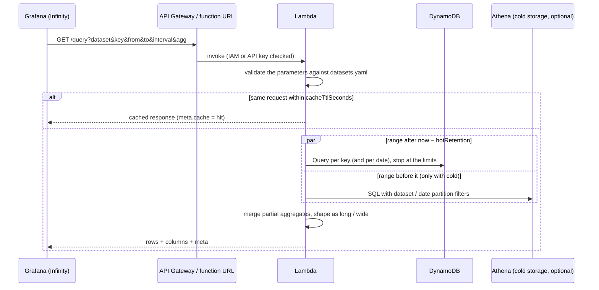

# 7. API reference

English | [日本語](../ja/07-api-reference.md) ｜ [Docs index](../README.md)

The base URL is the deployment output `Endpoint` (`https://<id>.execute-api.<region>.amazonaws.com/v1/` for the REST API, `https://<id>.lambda-url.<region>.on.aws/` for a function URL). All endpoints use GET, and responses are JSON (`content-type: application/json`).

## 7.1 GET /query

Returns time series.



### (1) Parameters

| Parameter | Required | Description |
|---|---|---|
| `dataset` | Yes | Dataset name |
| `key` | Yes | Key. Multiple keys comma-separated (duplicates and surrounding spaces are removed). Must match `keys.pattern` / `keys.values`, up to `limits.maxKeys` keys |
| `from` / `to` | Yes | UNIX time (milliseconds). Both ends are inclusive. `to - from` must be within `limits.maxRange` |
| `fields` | | Columns to return (comma-separated. Column names or attribute names). All columns if omitted |
| `interval` | | Aggregation bucket. An integer in milliseconds, or `30s` / `5m` / `1h` / `1d` |
| `agg` | | `avg` (default) / `min` / `max` / `sum` / `count` / `last`. Specify together with `interval` |
| `latest` | | `1` (or `true`) returns the latest single item per key. Cannot be specified together with `interval` |
| `format` | | `long` (default) / `wide` |
| `tz` | | Time zone of the aggregation buckets. The default is the dataset's time zone |

When `interval` is specified, `from` is rounded to the start of its bucket and `to` to the end of its bucket (the first bucket is not cut off, and the cache is hit more often).

### (2) Response

```json
{
  "rows": [
    { "time": 1793824440000, "key": "room-01", "temperature": 20.2, "humidity": 59.7 }
  ],
  "columns": [
    { "name": "temperature", "type": "number", "unit": "celsius" },
    { "name": "humidity", "type": "number", "unit": "percent" }
  ],
  "meta": {
    "dataset": "room_temp",
    "queries": 1, "pages": 1, "items": 60, "truncated": false, "consumedRcu": 0.5,
    "points": 12, "interval": 300000, "agg": "avg", "cache": "miss"
  }
}
```

| Field | Content |
|---|---|
| `rows` | long: `{ time, key, columns... }` ordered by time, then key. wide: `{ time, <key>_<column>... }` ordered by time (columns without a value are `null`) |
| `columns` | Column name, type, and unit. With `agg=count`, the type is `number` and there is no unit |
| `meta.queries` | Number of Queries run (keys × dates) |
| `meta.pages` / `meta.items` / `meta.consumedRcu` | Pages read, items read (including items excluded as out of range), consumed RCU |
| `meta.truncated` / `meta.truncatedBy` | Whether a limit truncated the result, and which limit (`maxItems` / `maxPages` / `maxRcu`) |
| `meta.points` | Number of points returned |
| `meta.interval` / `meta.agg` | Aggregation bucket and method (absent when not aggregated) |
| `meta.cache` | `hit` / `miss` |
| `meta.cold` | Details of the cold storage read ([Cold storage](09-cold-storage.md#94-queries)); absent when it was not read |

Value conversion:

| `type` | Conversion |
|---|---|
| `number` | A number, or a numeric string. Multiplied by `scale` and rounded to 12 significant digits |
| `string` | A string. Numbers and booleans become strings, Map / List become JSON strings |
| `boolean` | `true` / `1` / `"true"` / `"1"` → true, `false` / `0` / `"false"` / `"0"` → false (case-insensitive) |
| `json` | A JSON string. Sets become arrays, Binary becomes Base64 |

Missing values and values that cannot be converted are `null`.

## 7.2 GET /datasets

Returns the list of datasets. Table names and attribute names are not returned.

```json
[
  {
    "name": "room_temp",
    "description": "Temperature and humidity per room (sample)",
    "columns": [{ "name": "temperature", "type": "number", "unit": "celsius" }],
    "maxRange": "31d",
    "maxKeys": 20
  }
]
```

The `description` above is the sample dataset's description ("temperature and humidity per room (sample)").

## 7.3 GET /keys?dataset=

Returns the list of keys (for Grafana template variables).

```json
[{ "key": "room-01" }, { "key": "room-02" }]
```

With settings that cannot build a list (neither `keys.values` nor `keys.list`), it returns an empty array and puts the reason in the `x-tsapi-hint` header.

## 7.4 Errors

Error responses are `{ "error": "reason" }`. The messages are in Japanese.

| Status | Main reasons |
|---|---|
| 400 | Invalid parameters (table below), response too large (over 5.5MB) |
| 403 | Authentication failure (returned by API Gateway / the function URL. The body is in API Gateway format) |
| 404 | Undefined dataset, unknown path |
| 500 | DynamoDB error (`error name: message`) |

Main 400 messages:

| Message | Cause |
|---|---|
| `Specify dataset` | `dataset` is missing |
| `Specify key (comma-separated for multiple keys)` | `key` is missing |
| `Key X is not allowed (keys.pattern / keys.values)` | Key not allowed |
| `Up to N keys can be specified (limits.maxKeys)` | Too many keys |
| `Specify from as UNIX time in milliseconds. ...` | `from` / `to` is not a number |
| `from must be earlier than or equal to to` | `from > to` |
| `The time range is too long. Keep it within 31d (limits.maxRange)` | The period exceeds `maxRange` |
| `X in fields is not defined in the dataset. ...` | Column not in the definition |
| `interval must be milliseconds (...) or 30s / 5m / 1h / 1d` | `interval` format |
| `agg must be one of ...` / `agg requires interval` | Invalid `agg` |
| `latest and interval cannot be used together` | Invalid combination |
| `format must be one of long / wide` | Invalid `format` |
| `tz must be UTC, ...` | Invalid time zone |
| `X=...: a Grafana variable was not replaced. ...` | A template variable or `$__interval_ms` arrived as is (alerts, etc.) |
| `The response is too large (...)` | The response exceeds 5.5MB |

## 7.5 Authentication

| Method | Request |
|---|---|
| IAM (REST API) | SigV4 signing (service name `execute-api`) |
| IAM (function URL) | SigV4 signing (service name `lambda`) |
| API key | `x-api-key` header |

Example with curl (IAM, curl 7.75 or later):

```bash
curl --aws-sigv4 "aws:amz:ap-northeast-1:execute-api" \
  --user "$AWS_ACCESS_KEY_ID:$AWS_SECRET_ACCESS_KEY" \
  -H "x-amz-security-token: $AWS_SESSION_TOKEN" \
  "https://<id>.execute-api.ap-northeast-1.amazonaws.com/v1/datasets"
```

If you are not using temporary credentials, remove the `x-amz-security-token` line. This curl example has not been tested. To check reliably, use `pnpm check`.
