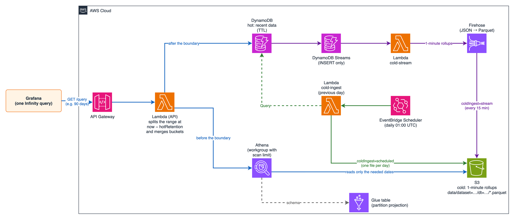
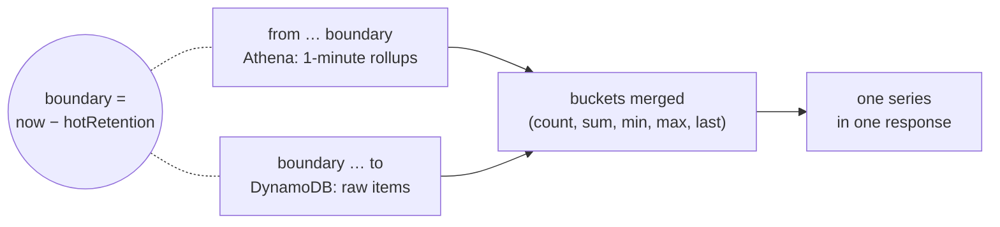
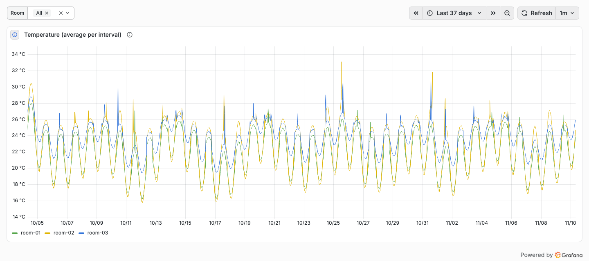
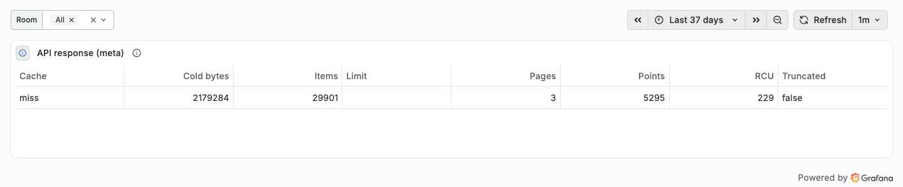

# 9. Cold storage (hot + cold)

English | [日本語](../ja/09-cold-storage.md) ｜ [Documentation index](../README.md)

Recent data (hot) is read from DynamoDB and older data (cold) from S3 + Athena, and **one query returns them as a single series**. On the Grafana side, it is still the same single Infinity query.



- Keep only recent data (7 days by default) in DynamoDB (TTL), which reduces storage cost and the amount read
- Cold storage keeps the count, sum, min, max, and last value per minute. These can be merged across buckets, so averages and counts stay correct even for a bucket that spans the boundary
- Two ingestion modes: **scheduled** (once a day, the previous day) / **stream** (DynamoDB Streams)

## 9.1 Enabling it

### (1) datasets.yaml

Add `cold` to a dataset.

```yaml
datasets:
  room_temp:
    # ... (existing settings)
    cold:
      hotRetention: 7d   # older data is read from cold storage (default 7d)
      maxRange: 400d     # maximum range of one query (default 400d; used instead of limits.maxRange)
```

| Key | Default | Meaning |
|---|---|---|
| `type` | `athena` | Where cold data is read from (only Athena for now) |
| `hotRetention` | `7d` | Boundary = now − hotRetention (truncated to the minute). `90m` / `12h` / `7d` format |
| `maxRange` | `400d` | For datasets with `cold`, the range is checked against this value instead of `limits.maxRange` (the DynamoDB part never exceeds hotRetention) |

### (2) Deploy

```bash
pnpm cdk-deploy -c cold=true                          # scheduled (default)
pnpm cdk-deploy -c cold=true -c coldIngest=stream     # stream
```

| Option | Default | Meaning |
|---|---|---|
| `cold` | `false` | `true` creates the cold storage |
| `coldIngest` | `scheduled` | `scheduled` (once a day, previous day) / `stream` (DynamoDB Streams) |
| `coldScanLimitGb` | `1` | Maximum data Athena scans per query (GB, 1–1024), enforced by the workgroup |
| `coldRemovalPolicy` | `retain` | Bucket on `cdk destroy`. `retain`: keep it / `destroy`: delete it with its contents |
| `bucket_suffix` | account ID | Suffix of the S3 bucket name (`dynamodb-timeseries-api-cold-<suffix>`) |

Mismatches between the configuration and the options stop the synth:

- A dataset has `cold` but `-c cold=true` is missing (or the other way round)
- `coldIngest=scheduled` but the keys cannot be listed (neither `keys.values` nor `keys.list`). Scheduled ingestion reads each key with Query (it never scans)

### (3) DynamoDB TTL

Hot data is removed by DynamoDB TTL. Enable TTL on the table and write a time (UNIX seconds) later than "hotRetention + 1 day" to each item. The extra day makes sure data just after the boundary has not been deleted yet (TTL deletion can be days late, but never early).

- The sample table (`-c sample=true`) has TTL enabled on `expiresAt`, and `pnpm seed` adds `expiresAt` when the dataset has `cold`
- It also works without TTL (the data simply stays in DynamoDB; the API still reads the part before the boundary from cold storage)

## 9.2 Resources

| Resource | Name | Notes |
|---|---|---|
| S3 bucket | `dynamodb-timeseries-api-cold-<account ID>` | `data/dataset=<name>/dt=yyyy-MM-dd/*.parquet` (1-minute rollups), `athena-results/` (expire after 1 day). Public access blocked, SSE-S3, TLS only |
| Glue database / table | `dynamodb_timeseries_api` / `cold` | Parquet, partitions `dataset` / `dt`. Partition projection, so no partition registration (MSCK REPAIR etc.) is needed |
| Athena workgroup | `dynamodb-timeseries-api` | Engine v3, enforces the per-query scan limit (`coldScanLimitGb`) |
| Lambda (scheduled) | `dynamodb-timeseries-api-cold-ingest` | 1024 MB, 15 minutes. EventBridge Scheduler invokes it every day at 01:00 UTC |
| Lambda (stream) | `dynamodb-timeseries-api-cold-stream` | Rolls up Streams INSERTs per minute and sends them to Firehose |
| Firehose (stream) | `dynamodb-timeseries-api-cold` | Converts JSON to Parquet and writes by dataset / dt, every 15 minutes or 128 MB |

The API Lambda gets only the workgroup, the Glue table, read access to `data/`, and read/write access to `athena-results/`.

### Columns of the cold table

| Column | Type | Meaning |
|---|---|---|
| `key` | string | Key |
| `field` | string | `fields[].name` (attribute name, not the alias) |
| `ts` | bigint | Start of the minute (UNIX ms) |
| `cnt` | bigint | Number of non-missing values |
| `val_sum` / `val_min` / `val_max` / `val_last` | double | Sum, min, max, and last value of numeric fields |
| `text_last` | string | Last value of non-numeric fields |
| `last_ts` | bigint | Time of the last value |
| `dataset` / `dt` | string (partitions) | Dataset name / UTC date |

## 9.3 Ingestion

| | Scheduled (`scheduled`) | Stream (`stream`) |
|---|---|---|
| How | Every day at 01:00 UTC, reads the previous day (UTC) per key with Query | A Lambda rolls up Streams INSERTs per minute; Firehose writes them as Parquet |
| Requires | `keys.values` or `keys.list` | Streams (with new images) enabled on the table (automatic for the sample table) |
| Files per day | One (`part-0.parquet`) | One per Firehose delivery (at most every 15 minutes) |
| Re-running | Idempotent (replaces the date folder) | Appends. Updates (MODIFY) are not ingested |
| DynamoDB reads | Reads one day once (consumes RCU) | None (reading Streams from Lambda is free) |
| Cost | Lambda and RCU | Lambda and Firehose (charged by volume for ingestion, format conversion, and dynamic partitioning) |

In both modes, cold data is read only before hotRetention, so a delay of a few hours in ingestion does not change what is displayed.

### (1) Backfilling (pnpm cold-backfill)

Ingests days still in DynamoDB with the same code as the scheduled ingestion. Run it from your machine (AWS credentials required).

```bash
pnpm cold-backfill --days 7                                           # 7 days back from yesterday (UTC)
pnpm cold-backfill --from 2026-11-01 --to 2026-11-05 --dataset room_temp
```

It replaces the contents of each date folder, so it can also compact the small files written by the stream mode into one file per day (while that day's data is still in DynamoDB).

### (2) Notes on the stream mode

- For existing tables, enable Streams before deploying (`StreamViewType` `NEW_IMAGE` or `NEW_AND_OLD_IMAGES`). The stream ARN is looked up at deploy time
- The event source mapping starts at `LATEST`. Items written right after the deployment, before the mapping becomes active (it took about 40 seconds in our test), are not ingested. Backfill that day with `pnpm cold-backfill` if needed
- Only INSERTs are ingested. Overwriting an item with the same key and time is a MODIFY and is skipped (so counts are not doubled). Rebuild such days with `pnpm cold-backfill`
- If several datasets read the same table, one stream feeds all of them (the key is extracted by matching the partition key value against `template`)

### (3) Sample data (pnpm seed --cold-days)

```bash
pnpm seed --cold-days 30
```

After writing 7 days to DynamoDB, it writes the 30 days before that directly to S3 as 1-minute rollups. It does not go through DynamoDB, so 37 days of data are ready in tens of seconds.

## 9.4 Queries



The parameters are unchanged.

| Query | Cold range |
|---|---|
| With `interval` | Re-aggregated per bucket in Athena and merged with the DynamoDB buckets |
| Without `interval` (raw) | 1-minute averages (last value for non-numeric fields) |
| `latest=1` | Reads DynamoDB first, and Athena only for keys not found |

`meta.cold` in the response describes the cold read (absent when cold storage was not read).

```json
"cold": { "from": 1791039600000, "to": 1793635499999, "rows": 93, "bytesScanned": 2179284, "engineMs": 900, "truncated": false }
```

| Field | Meaning |
|---|---|
| `from` / `to` | Range read from cold storage (UNIX ms) |
| `rows` | Rows returned by Athena (key × field × bucket) |
| `bytesScanned` | Data scanned by Athena (the billing unit; under 10 MB is billed as 10 MB) |
| `engineMs` | Athena execution time |
| `truncated` | Whether rows exceeded `limits.maxItems` and were cut (`meta.truncatedBy` is `maxItems`) |

### Measurements (ap-northeast-1, November 2026)

37 days in one panel (the last 7 days from DynamoDB, older data from S3 + Athena). The lines connect at the boundary.

<picture>
  <source media="(prefers-color-scheme: dark)" srcset="../images/cold-37-days-dark.png">
  
</picture>

Add a `cold.bytesScanned` column (Cold bytes) to the meta table to see how much Athena scanned ("API response (meta)" in the sample dashboard).

<picture>
  <source media="(prefers-color-scheme: dark)" srcset="../images/cold-meta-dark.png">
  
</picture>

Measured with the sample (3 rooms, 7 days in DynamoDB + 30 days in cold storage).

| Query | Time | Athena scanned |
|---|---|---|
| 37 days, daily average (3 rooms) | 2.8–4.4 s (0.14 s from the cache the second time) | 2.2 MB |
| 37 days, hourly average | 2.8 s | 2.2 MB |
| 12 hours around the boundary, hourly average | 1.9 s | 0.06 MB |
| Latest value from cold storage only | 1.9 s | 0.78 MB |

- Most of the time is spent starting the Athena query and waiting for it to finish (the execution itself took 0.6–1.1 s)
- For the same day, the values aggregated from cold storage by Athena matched those aggregated from DynamoDB (average, min, max, count)
- Stream: 1,364 INSERTs became 2,726 one-minute rollup rows, and 15 minutes later Firehose wrote one file per date (readable by Athena as is). Compacting that day with `pnpm cold-backfill` gave the same counts

### Limitations

- Athena queries are stopped after 20 seconds and the API returns 504 (API Gateway's limit is 29 seconds)
- The time zone offset for buckets is fixed at the start of the query range (across a DST change, buckets after the change are off by one hour)
- Cold storage has 1-minute resolution. With an `interval` shorter than one minute, the cold range still has one value per minute

## 9.5 Cost

- The only standing cost is S3 storage (1-minute rollups are about 75 KB per day for 3 keys × 2 fields). Athena, Lambda, and Firehose are all pay-per-use
- Athena charges by data scanned (minimum 10 MB per query). Date partitions narrow what is read. `coldScanLimitGb` caps a single query
- Each Grafana auto-refresh calls Athena. A longer API cache (`cacheTtlSeconds`) reduces the number of calls

## 9.6 Cleaning up

```bash
pnpm cdk-destroy -c cold=true   # use the same -c options as the deployment
```

By default (`coldRemovalPolicy=retain`) the bucket is kept. Delete it with its contents if you no longer need it.

```bash
aws s3 rb s3://dynamodb-timeseries-api-cold-<account ID> --force
```

If you intend to delete everything anyway (for example, for a trial), deploy with `-c coldRemovalPolicy=destroy` so that `cdk destroy` also deletes the bucket. In that case, the log group of the Lambda function that CDK creates to empty the bucket (`/aws/lambda/DynamodbTimeseriesApiStac-CustomS3AutoDeleteObject-...`) remains after the deletion (it is almost empty). Delete it if you do not need it.

```bash
aws logs describe-log-groups --log-group-name-prefix /aws/lambda/DynamodbTimeseriesApiStac --query 'logGroups[].logGroupName'
aws logs delete-log-group --log-group-name <name shown above>
```

## Next

- [API reference](07-api-reference.md)
- [Operations and troubleshooting](06-operations.md)
