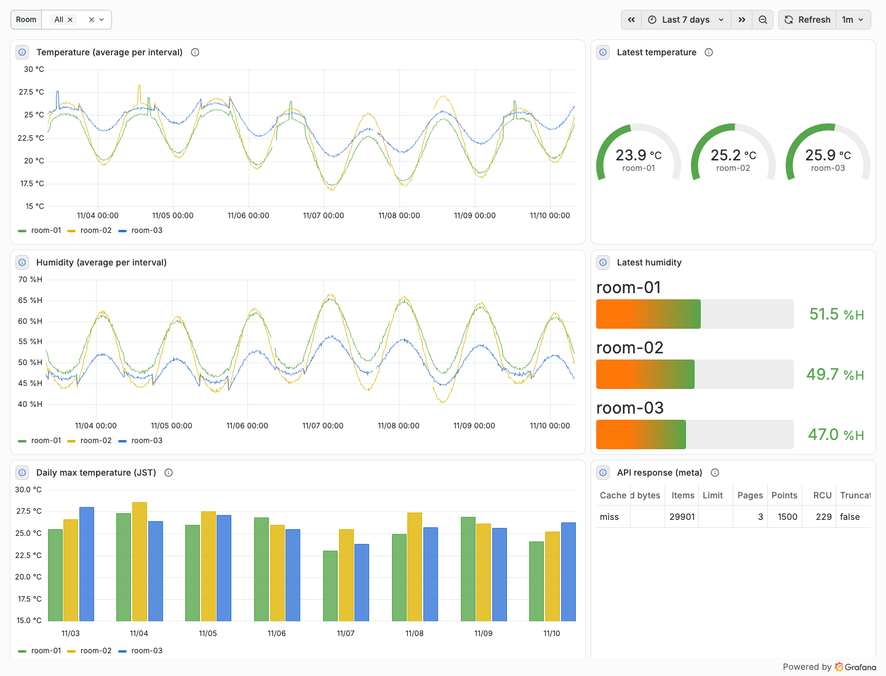

# 1. 導入

[English](../en/01-getting-started.md) | 日本語 ｜ [手順書の目次](../README.md)

サンプルのテーブルと疑似センサーのデータを使って、デプロイから Grafana でダッシュボードを表示するまでを順に説明します。所要時間は 15 分ほどです。AWS を使わずに試す方法は [AWS を使わずに試す](#aws-を使わずに試す) にあります。

## 1.1 必要なもの

| もの | 確認したバージョン | 用途 |
|---|---|---|
| Node.js | 22.23.4（22 以上） | CDK とスクリプトの実行。Lambda のランタイムは nodejs24.x |
| pnpm | 10.24.0（10 以上） | 依存の導入とコマンドの実行（npm / npx は使いません） |
| Docker | 29.5.3 | ローカルの Grafana と DynamoDB Local |
| AWS CLI | v2 | アクセスキーの作成など |
| AWS アカウント | | デプロイ先 |

デプロイには、CloudFormation、IAM、Lambda、API Gateway、DynamoDB、CloudWatch Logs のリソースを作れる権限が必要です。

pnpm がなければ、Node.js に付属の Corepack で入れられます。

```bash
corepack enable
corepack prepare pnpm@10.24.0 --activate
```

## 1.2 取得と依存の導入

```bash
git clone https://github.com/furuya02/dynamodb-timeseries-api.git
cd dynamodb-timeseries-api
pnpm install
```

## 1.3 AWS の認証情報とリージョン

AWS CLI と同じ認証情報（環境変数、`~/.aws/config` のプロファイル、IAM Identity Center など）を使います。

```bash
aws sts get-caller-identity   # 使うアカウントを確かめる
export AWS_REGION=ap-northeast-1
```

- CDK のデプロイ先リージョンは、プロファイルのリージョン（なければ ap-northeast-1）です
- スクリプト（`pnpm seed` など）は `AWS_REGION`（なければ ap-northeast-1）を使います。ap-northeast-1 以外にデプロイするときは、`AWS_REGION` を同じリージョンにそろえてください

このアカウントとリージョンで CDK を初めて使う場合は、bootstrap が必要です（1 回だけ）。

```bash
pnpm --dir cdk exec cdk bootstrap
```

## 1.4 デプロイ

サンプルテーブル（`-c sample=true`）と、Grafana 用の IAM ユーザー（`-c grafanaUser=true`）を一緒に作ります。

```bash
pnpm cdk-deploy -c sample=true -c grafanaUser=true
```

2 分ほどで終わり、出力が表示されます。

```
Outputs:
DynamodbTimeseriesApiStack.CreateAccessKeyCommand = aws iam create-access-key --user-name dynamodb-timeseries-api-grafana
DynamodbTimeseriesApiStack.Endpoint = https://xxxxxxxxxx.execute-api.ap-northeast-1.amazonaws.com/v1/
DynamodbTimeseriesApiStack.GrafanaPolicyArn = arn:aws:iam::123456789012:policy/dynamodb-timeseries-api-invoke
DynamodbTimeseriesApiStack.GrafanaUserName = dynamodb-timeseries-api-grafana
DynamodbTimeseriesApiStack.Region = ap-northeast-1
```

| 出力 | 意味 |
|---|---|
| Endpoint | API のベース URL。Grafana のデータソースに設定する |
| Region | Grafana の AWS 認証に設定するリージョン |
| GrafanaPolicyArn | API を呼ぶ権限だけを持つ管理ポリシー |
| GrafanaUserName / CreateAccessKeyCommand | Grafana 用の IAM ユーザーと、アクセスキーを作るコマンド |

作られるリソース: Lambda 関数（`dynamodb-timeseries-api`）、REST API（ステージ `v1`）、CloudWatch Logs のロググループ（保持 7 日）、IAM（Lambda の実行ロール、Grafana 用の管理ポリシーとユーザー）、DynamoDB テーブル（`dynamodb-timeseries-api-sample`、オンデマンド課金）。

## 1.5 サンプルデータの投入

```bash
pnpm seed
```

3 部屋（room-01〜03）× 7 日分 × 1 分おき（約 3 万件）の温度と湿度を書き込みます。30 秒ほどかかります。
実際のセンサーに近づけるため、日ごとの天気の違い、平日 9〜18 時の空調、部屋ごとの振れ幅の違い（room-02 は窓際で大きく、room-03 は内側で小さい）、ときどきの一時的な高温（+5℃、40 分）、短いデータの欠け（30〜90 分）を入れています。何度実行しても同じデータになります。期間と部屋数は `--days`、`--rooms`、間隔（分）は `--step` で変えられます。

## 1.6 接続の確認

Grafana の設定の前に、API が応答することを確かめます。

```bash
pnpm check
```

```
Endpoint: https://xxxxxxxxxx.execute-api.ap-northeast-1.amazonaws.com/v1/
Auth: IAM (SigV4, service execute-api, ap-northeast-1)

OK GET /datasets（161ms）: room_temp
OK GET /keys?dataset=room_temp（114ms）: room-01, room-02, room-03
OK GET /query last 1 hour, 5-minute average (73ms): 12 points, items read 60, consumed RCU 0.5
OK GET /query latest value (101ms): 2026-11-04T20:59:00.000Z {"time":...,"key":"room-01","temperature":20.3,"humidity":59.2}
```

`pnpm check` は CloudFormation の出力からエンドポイントと認証方式を読み、自分の認証情報で SigV4 署名して呼びます。NG と表示された場合は、表示される原因の案内か、[運用とトラブルシューティング](06-operations.md) を参照してください。

## 1.7 Grafana で表示する

ローカルの Docker で Grafana OSS 13.3.1 と Infinity 4.1.5 を起動します。

### (1) アクセスキーを作る

```bash
aws iam create-access-key --user-name dynamodb-timeseries-api-grafana
```

表示された `AccessKeyId` と `SecretAccessKey` を環境変数に入れます。このキーは API を呼ぶ権限だけを持ちます。キーは CloudFormation の管理外なので、片付けのときに手で削除します。

```bash
export TSAPI_AWS_ACCESS_KEY_ID=AKIA...
export TSAPI_AWS_SECRET_ACCESS_KEY=...
```

### (2) データソース設定を作り、Grafana を起動する

```bash
pnpm grafana-config
pnpm grafana-up
```

`pnpm grafana-config` は、デプロイの出力から `grafana/provisioning/generated/datasources/dynamodb-timeseries-api.yaml` を作ります。アクセスキーの値はファイルに書かず、Grafana の起動時に環境変数から読みます。

Linux の Docker では、代わりに次のコマンドで起動します（Docker Desktop / Rancher Desktop では不要です）。

```bash
docker compose -f grafana/docker-compose.yml -f grafana/docker-compose.linux.yml up -d
```

### (3) ダッシュボードを開く

http://localhost:3000/ を開き、「Dashboards」→「dynamodb-timeseries-api」→「Room temperature and humidity (dynamodb-timeseries-api sample)」を選びます。

<picture>
  <source media="(prefers-color-scheme: dark)" srcset="../images/dashboard-dark.png">
  
</picture>

- ログインなしで閲覧できます（Grafana 13 の匿名アクセスは閲覧者のみ）
- 編集するときは右上の「Sign in」から admin / admin でログインします
- 部屋は上部の「Room」で選べます（複数選択）

| パネル | 内容 |
|---|---|
| Temperature / Humidity (average per interval) | 表示期間に合わせて API 側で集計した推移 |
| Latest temperature / Latest humidity | 部屋ごとの最新値（ゲージ / バーゲージ） |
| Daily max temperature (JST) | JST の 0 時で区切った 1 日ごとの最高気温（棒グラフ） |
| API response (meta) | 読んだ件数、消費 RCU、打ち切り、キャッシュ |

サンプルのアラートルール（最新の温度が 29℃ を超えた状態が 5 分続いたら）も、「Alerting」→「Alert rules」に読み込まれます。

## 1.8 費用の目安

- 上の手順（デプロイ、約 3 万件の投入、数百回の問い合わせ）は、ap-northeast-1 で $0.1 未満でした（2026/11 時点）
- 置いておくだけの費用はほぼかかりません。Lambda と DynamoDB はオンデマンド、REST API はリクエスト数に応じた課金です
- Grafana のダッシュボードを開いたままにすると、自動更新（1 分ごと）のたびに API が呼ばれます

## 1.9 片付け

確認が終わったら、[運用とトラブルシューティング](06-operations.md#65-片付け) の手順で削除します。CDK の管理外で作ったアクセスキーを先に削除しないと、IAM ユーザーを削除できません。

## AWS を使わずに試す

DynamoDB Local と、API をローカルで動かす `pnpm local-api` を使います。AWS の認証情報は不要です。

```bash
pnpm install
pnpm grafana-config --local
docker compose -f grafana/docker-compose.yml --profile local up -d   # Grafana と DynamoDB Local（ポート 8000）

export AWS_ENDPOINT_URL_DYNAMODB=http://localhost:8000 AWS_REGION=ap-northeast-1 AWS_ACCESS_KEY_ID=local AWS_SECRET_ACCESS_KEY=local
pnpm seed --create      # テーブルを作ってサンプルデータを投入
pnpm local-api          # ポート 13000。別のターミナルで起動したままにする
```

http://localhost:3000/ でダッシュボードを表示できます。別のターミナルで `pnpm check --endpoint http://localhost:13000` を実行すると、API の応答も確かめられます。

- DynamoDB Local はメモリ上にデータを持つため、コンテナを作り直したら `pnpm seed --create` をやり直します
- 終わったら `docker compose -f grafana/docker-compose.yml --profile local down` で停止します

## 次に読む

- [データセットの定義](02-datasets.md): 自分のテーブルを使う
- [Grafana との接続](03-grafana.md): Grafana Cloud や Amazon Managed Grafana、既存の Grafana から接続する
