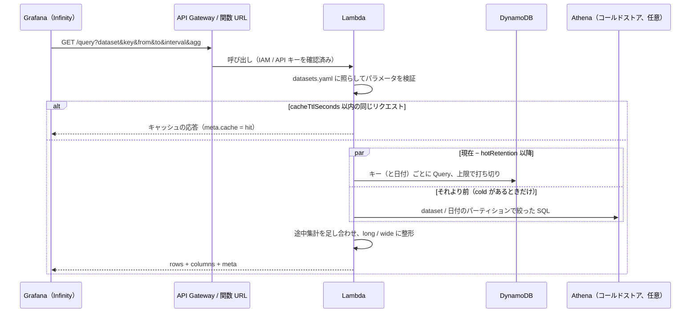

# 7. API リファレンス

[English](../en/07-api-reference.md) | 日本語 ｜ [手順書の目次](../README.md)

ベース URL はデプロイの出力 `Endpoint` です（REST API なら `https://<id>.execute-api.<region>.amazonaws.com/v1/`、関数 URL なら `https://<id>.lambda-url.<region>.on.aws/`）。すべて GET で、応答は JSON（`content-type: application/json`）です。

## 7.1 GET /query

時系列を返します。



### (1) パラメータ

| パラメータ | 必須 | 説明 |
|---|---|---|
| `dataset` | ○ | データセット名 |
| `key` | ○ | キー。カンマ区切りで複数（重複と前後の空白は除く）。`keys.pattern` / `keys.values` に合うもの、`limits.maxKeys` 個まで |
| `from` / `to` | ○ | UNIX 時刻（ミリ秒）。両端を含む。`to - from` は `limits.maxRange` 以内 |
| `fields` | | 返す列（カンマ区切り。列名・属性名のどちらでも）。省略すると全列 |
| `interval` | | 集計の区切り。ミリ秒の整数、または `30s` / `5m` / `1h` / `1d` |
| `agg` | | `avg`（既定）/ `min` / `max` / `sum` / `count` / `last`。`interval` と一緒に指定する |
| `latest` | | `1`（または `true`）でキーごとに最新の 1 件。`interval` とは同時に指定できない |
| `format` | | `long`（既定）/ `wide` |
| `tz` | | 集計の区切りのタイムゾーン。既定はデータセットのタイムゾーン |

`interval` を指定すると、`from` は区切りの先頭、`to` は区切りの末尾に丸めます（先頭の区切りが欠けず、キャッシュにも当たりやすくなります）。

### (2) 応答

```json
{
  "rows": [
    { "time": 1793824440000, "key": "room-01", "temperature": 20.2, "humidity": 59.7 }
  ],
  "columns": [
    { "name": "temperature", "type": "number", "unit": "celsius" },
    { "name": "humidity", "type": "number", "unit": "percent" }
  ],
  "meta": {
    "dataset": "room_temp",
    "queries": 1, "pages": 1, "items": 60, "truncated": false, "consumedRcu": 0.5,
    "points": 12, "interval": 300000, "agg": "avg", "cache": "miss"
  }
}
```

| 項目 | 内容 |
|---|---|
| `rows` | long: `{ time, key, 列... }` を時刻 → キーの順に。wide: `{ time, <key>_<列>... }` を時刻順に（値がない列は `null`） |
| `columns` | 列名、型、単位。`agg=count` のときは型が `number` で単位なし |
| `meta.queries` | 実行した Query の数（キー × 日付） |
| `meta.pages` / `meta.items` / `meta.consumedRcu` | 読んだページ数、件数（範囲外で除いたものを含む）、消費 RCU |
| `meta.truncated` / `meta.truncatedBy` | 上限で打ち切ったか、どの上限か（`maxItems` / `maxPages` / `maxRcu`） |
| `meta.points` | 返した点の数 |
| `meta.interval` / `meta.agg` | 集計の区切りと方法（集計しないときはなし） |
| `meta.cache` | `hit` / `miss` |
| `meta.cold` | コールドストアの読み込みの情報（[コールドストア](09-cold-storage.md#94-問い合わせ)）。読まなかったときはなし |

値の変換:

| `type` | 変換 |
|---|---|
| `number` | 数値、または数値の文字列。`scale` を掛け、有効数字 12 桁で丸める |
| `string` | 文字列。数値・真偽値は文字列に、Map / List は JSON 文字列に |
| `boolean` | `true` / `1` / `"true"` / `"1"` → true、`false` / `0` / `"false"` / `"0"` → false（大文字小文字は問わない） |
| `json` | JSON 文字列。Set は配列、Binary は Base64 |

欠損と変換できない値は `null` です。

## 7.2 GET /datasets

データセットの一覧を返します。テーブル名や属性名は返しません。

```json
[
  {
    "name": "room_temp",
    "description": "Temperature and humidity per room (sample)",
    "columns": [{ "name": "temperature", "type": "number", "unit": "celsius" }],
    "maxRange": "31d",
    "maxKeys": 20
  }
]
```

## 7.3 GET /keys?dataset=

キーの一覧を返します（Grafana のテンプレート変数用）。

```json
[{ "key": "room-01" }, { "key": "room-02" }]
```

一覧を作れない設定（`keys.values` も `keys.list` もない）では空の配列を返し、ヘッダー `x-tsapi-hint` に理由を入れます。

## 7.4 エラー

エラーの応答は `{ "error": "理由" }` です。

| ステータス | 主な理由 |
|---|---|
| 400 | パラメータの誤り（下の表）、応答が大きすぎる（5.5MB 超） |
| 403 | 認証の失敗（API Gateway / 関数 URL が返す。本文は API Gateway の形式） |
| 404 | 未定義のデータセット、未知のパス |
| 500 | DynamoDB のエラー（`エラー名: 内容`） |

400 の主なメッセージ（メッセージは英語です）:

| メッセージ | 原因 |
|---|---|
| `Specify dataset` | `dataset` がない |
| `Specify key (comma-separated for multiple keys)` | `key` がない |
| `Key X is not allowed (keys.pattern / keys.values)` | 許可されないキー |
| `Up to N keys can be specified (limits.maxKeys)` | キーが多すぎる |
| `Specify from as UNIX time in milliseconds. ...` | `from` / `to` が数値でない |
| `from must be earlier than or equal to to` | `from > to` |
| `The time range is too long. Keep it within 31d (limits.maxRange)` | 期間が `maxRange` を超える |
| `X in fields is not defined in the dataset. ...` | 定義にない列 |
| `interval must be milliseconds (...) or 30s / 5m / 1h / 1d` | `interval` の形式 |
| `agg must be one of ...` / `agg requires interval` | `agg` の誤り |
| `latest and interval cannot be used together` | 組み合わせの誤り |
| `format must be one of long / wide` | `format` の誤り |
| `tz must be UTC, ...` | タイムゾーンの誤り |
| `X=...: a Grafana variable was not replaced. ...` | テンプレート変数や `$__interval_ms` がそのまま届いた（アラートなど） |
| `The response is too large (...)` | 応答が 5.5MB を超える |

## 7.5 認証

| 方式 | リクエスト |
|---|---|
| IAM（REST API） | SigV4 署名（サービス名 `execute-api`） |
| IAM（関数 URL） | SigV4 署名（サービス名 `lambda`） |
| API キー | ヘッダー `x-api-key` |

curl で試す例（IAM、curl 7.75 以上）:

```bash
curl --aws-sigv4 "aws:amz:ap-northeast-1:execute-api" \
  --user "$AWS_ACCESS_KEY_ID:$AWS_SECRET_ACCESS_KEY" \
  -H "x-amz-security-token: $AWS_SESSION_TOKEN" \
  "https://<id>.execute-api.ap-northeast-1.amazonaws.com/v1/datasets"
```

一時的な認証情報でない場合は、`x-amz-security-token` の行を外します。この curl の例は動作を確かめていません。確実に確かめるには `pnpm check` を使ってください。
