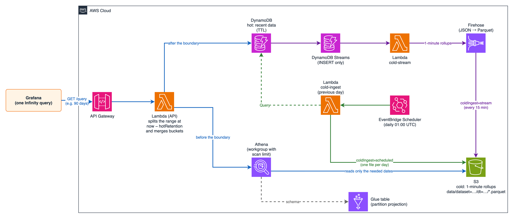
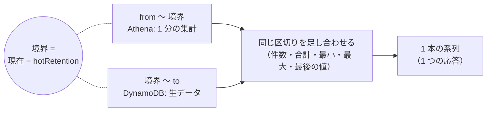
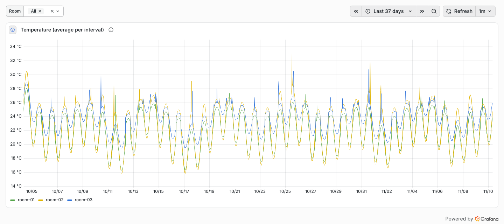
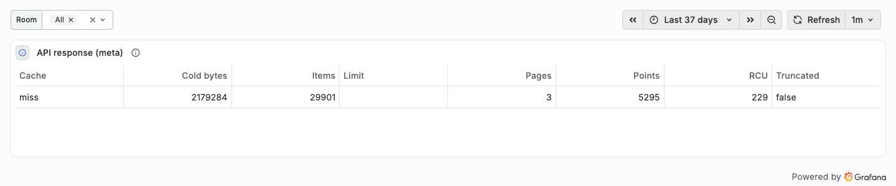

# 9. コールドストア（ホット + コールド）

[English](../en/09-cold-storage.md) | 日本語 ｜ [手順書の目次](../README.md)

直近のデータ（ホット）は DynamoDB から、それより前のデータ（コールド）は S3 + Athena から読み、**1 つのクエリで 1 本の系列として返す**機能です。Grafana 側は、これまでと同じ Infinity の 1 クエリのままです。



- DynamoDB には直近（既定 7 日）だけを残し（TTL）、保存の費用と読み込みの量を抑えます
- コールドには 1 分ごとの件数・合計・最小・最大・最後の値を保存します。区切りをまたいで足し合わせられる形なので、境界をまたぐ区切りでも平均・件数が正しく出ます
- 取り込みは 2 通りから選べます: **定期実行**（1 日 1 回、前日分）/ **ストリーム**（DynamoDB Streams）

## 9.1 有効にする

### (1) datasets.yaml

データセットに `cold` を書きます。

```yaml
datasets:
  room_temp:
    # ...（これまでの設定）
    cold:
      hotRetention: 7d   # これより前はコールドから読む（既定 7d）
      maxRange: 400d     # 1 回で問い合わせられる期間（既定 400d。limits.maxRange の代わりに使う）
```

| 項目 | 既定値 | 内容 |
|---|---|---|
| `type` | `athena` | 読み先の種類（今は Athena のみ） |
| `hotRetention` | `7d` | 境界 = 現在 − hotRetention（1 分単位に切り捨て）。`90m` / `12h` / `7d` の形式 |
| `maxRange` | `400d` | cold のあるデータセットでは `limits.maxRange` の代わりにこの値で期間を確かめる（DynamoDB を読む期間は hotRetention までに収まるため） |

### (2) デプロイ

```bash
pnpm cdk-deploy -c cold=true                          # 定期実行（既定）
pnpm cdk-deploy -c cold=true -c coldIngest=stream     # ストリーム
```

| オプション | 既定値 | 内容 |
|---|---|---|
| `cold` | `false` | `true` でコールドストアを作る |
| `coldIngest` | `scheduled` | `scheduled`（1 日 1 回、前日分）/ `stream`（DynamoDB Streams） |
| `coldScanLimitGb` | `1` | Athena が 1 回の問い合わせで読む量の上限（GB、1〜1024）。ワークグループで強制する |
| `coldRemovalPolicy` | `retain` | `cdk destroy` のときのバケット。`retain`: 残す / `destroy`: 中身ごと消す |
| `bucket_suffix` | アカウント ID | S3 バケット名の末尾（`dynamodb-timeseries-api-cold-<suffix>`） |

設定とオプションが合わない場合は、synth の時点で止まります。

- cold を書いたデータセットがあるのに `-c cold=true` がない（またはその逆）
- `coldIngest=scheduled` で、キーを列挙できない（`keys.values` も `keys.list` もない）。定期実行はキーごとに Query で読むため（Scan はしません）

### (3) DynamoDB の TTL

ホットのデータを消すのは DynamoDB の TTL です。テーブルで TTL を有効にし、アイテムに「hotRetention + 1 日」より後の時刻（UNIX 秒）を書いてください。1 日の余裕は、境界の直後のデータがまだ消えていないようにするためです（TTL の削除は数日遅れることもあり、早く消えることはありません）。

- サンプルテーブル（`-c sample=true`）は TTL 属性 `expiresAt` を有効にしてあり、`pnpm seed` はデータセットに cold があれば `expiresAt` を付けます
- TTL を付けなくても動きます（DynamoDB に残り続けるだけで、API は境界より前をコールドから読みます）

## 9.2 作られるリソース

| リソース | 名前 | 内容 |
|---|---|---|
| S3 バケット | `dynamodb-timeseries-api-cold-<アカウント ID>` | `data/dataset=名前/dt=yyyy-MM-dd/*.parquet`（1 分の集計）、`athena-results/`（1 日で削除）。公開ブロック、SSE-S3、SSL のみ |
| Glue データベース / テーブル | `dynamodb_timeseries_api` / `cold` | Parquet、パーティション `dataset` / `dt`。パーティション射影なので、パーティションの登録（MSCK REPAIR など）は不要 |
| Athena ワークグループ | `dynamodb-timeseries-api` | エンジン v3、1 回の読み込み量の上限（`coldScanLimitGb`）を強制 |
| Lambda（定期実行） | `dynamodb-timeseries-api-cold-ingest` | 1024MB、15 分。EventBridge Scheduler が毎日 01:00 UTC に呼ぶ |
| Lambda（ストリーム） | `dynamodb-timeseries-api-cold-stream` | Streams の INSERT を 1 分に集計して Firehose へ |
| Firehose（ストリーム） | `dynamodb-timeseries-api-cold` | JSON → Parquet 変換、dataset / dt で分けて書く。15 分 / 128MB ごとに書く |

API の Lambda には、ワークグループ・Glue テーブル・`data/` の読み取り・`athena-results/` の読み書きだけを付けます。

### コールドのテーブルの列

| 列 | 型 | 内容 |
|---|---|---|
| `key` | string | キー |
| `field` | string | `fields[].name`（属性名。alias ではない） |
| `ts` | bigint | 1 分の区切りの開始（UNIX ミリ秒） |
| `cnt` | bigint | 欠損を除いた件数 |
| `val_sum` / `val_min` / `val_max` / `val_last` | double | 数値の列の合計・最小・最大・最後の値 |
| `text_last` | string | 数値以外の列の最後の値 |
| `last_ts` | bigint | 最後の値の時刻 |
| `dataset` / `dt` | string（パーティション） | データセット名 / UTC の日付 |

## 9.3 取り込み

| | 定期実行（`scheduled`） | ストリーム（`stream`） |
|---|---|---|
| 仕組み | 毎日 01:00 UTC に、前日分（UTC）をキーごとに Query で読む | Streams の INSERT を Lambda が 1 分に集計し、Firehose が Parquet にして書く |
| 前提 | `keys.values` か `keys.list` | テーブルの Streams（新しいイメージを含む）を有効にしておく（サンプルテーブルは自動） |
| 1 日のファイル | 1 つ（`part-0.parquet`） | Firehose が書くたびに 1 つ（最大 15 分ごと） |
| やり直し | 同じ日を何度取り込んでも重複しない（日付のフォルダを置き換える） | 追記。更新（MODIFY）は取り込まない |
| DynamoDB の読み込み | 1 日分を 1 回読む（RCU を消費） | なし（Streams の読み取りは Lambda からなら無料） |
| 費用 | Lambda と RCU | Lambda と Firehose（取り込み・形式変換・動的パーティショニングの量に応じた課金） |

どちらでも、コールドを読むのは hotRetention より前なので、取り込みが数時間遅れても表示は変わりません。

### (1) 過去分の取り込み（pnpm cold-backfill）

DynamoDB に残っている期間を、定期実行と同じ処理で取り込みます。手元から実行します（AWS の認証情報が必要です）。

```bash
pnpm cold-backfill --days 7                                           # 前日（UTC）から遡って 7 日分
pnpm cold-backfill --from 2026-11-01 --to 2026-11-05 --dataset room_temp
```

```
Ingesting room_temp from 2026-11-07 to 2026-11-08 (2 days, UTC) into s3://dynamodb-timeseries-api-cold-123456789012/
  room_temp 2026-11-07: keys 3, items read 4152, 1-minute rollup rows 8304, 83.1KB, consumed RCU 32.5
  room_temp 2026-11-08: keys 3, items read 4250, 1-minute rollup rows 8500, 84.7KB, consumed RCU 33
Done
```

日付のフォルダの中身を置き換えるので、ストリームで書かれた小さなファイルを 1 日 1 ファイルにまとめ直すのにも使えます（その日のデータが DynamoDB に残っている間）。

### (2) ストリームの注意

- 既存のテーブルは、デプロイの前に Streams を有効にしておきます（`StreamViewType` は `NEW_IMAGE` か `NEW_AND_OLD_IMAGES`）。デプロイ時にストリームの ARN を読み取ります
- イベントソースマッピングは `LATEST` から読みます。デプロイ直後、マッピングが有効になる前（確認では約 40 秒）に書いたアイテムは取り込まれません。必要なら、その日を `pnpm cold-backfill` で取り込みます
- 取り込むのは INSERT だけです。同じキー・時刻のアイテムを上書きすると MODIFY になり、取り込みません（件数を二重に数えないため）。直したい日は `pnpm cold-backfill` で作り直します
- テーブルを読むデータセットが複数あれば、1 つのストリームから全部に振り分けます（パーティションキーの値を template と突き合わせてキーを取り出します）

### (3) サンプルデータ（pnpm seed --cold-days）

```bash
pnpm seed --cold-days 30
```

DynamoDB に 7 日分を入れたあと、その前の 30 日分を 1 分の集計にして S3 に直接書きます。DynamoDB を経由しないので、37 日分のデータを数十秒で用意できます。

## 9.4 問い合わせ



パラメータはこれまでと同じです。

| 問い合わせ | コールドの範囲の扱い |
|---|---|
| `interval` あり | Athena で区切りごとに集計し直し、DynamoDB の区切りと足し合わせる |
| `interval` なし（生データ） | 1 分の平均（数値以外は最後の値）を返す |
| `latest=1` | まず DynamoDB を読み、見つからなかったキーだけ Athena を読む |

応答の `meta.cold` に、コールドの読み込みの情報が入ります（コールドを読まなかったときはなし）。

```json
"cold": { "from": 1791039600000, "to": 1793635499999, "rows": 93, "bytesScanned": 2179284, "engineMs": 900, "truncated": false }
```

| 項目 | 内容 |
|---|---|
| `from` / `to` | コールドから読んだ範囲（UNIX ミリ秒） |
| `rows` | Athena が返した行数（キー × 列 × 区切り） |
| `bytesScanned` | Athena が読んだ量（課金の単位。1 回 10MB 未満は 10MB として課金） |
| `engineMs` | Athena の実行時間 |
| `truncated` | 行数が `limits.maxItems` を超えて打ち切ったか（`meta.truncatedBy` は `maxItems`） |

### 実測（ap-northeast-1、2026/11）

37 日分を 1 つのパネルで表示した例です（直近 7 日が DynamoDB、それより前が S3 + Athena）。線は境界でつながっています。

<picture>
  <source media="(prefers-color-scheme: dark)" srcset="../images/cold-37-days-dark.png">
  
</picture>

meta に `cold.bytesScanned` の列（Cold bytes）を加えると、Athena が読んだ量を確認できます（サンプルダッシュボードの「API response (meta)」）。

<picture>
  <source media="(prefers-color-scheme: dark)" srcset="../images/cold-meta-dark.png">
  
</picture>

サンプル（3 部屋、DynamoDB 7 日分 + コールド 30 日分）で測りました。

| 問い合わせ | 所要時間 | Athena の読み込み量 |
|---|---|---|
| 37 日・1 日平均（3 部屋） | 2.8〜4.4 秒（2 回目はキャッシュで 0.14 秒） | 2.2MB |
| 37 日・1 時間平均 | 2.8 秒 | 2.2MB |
| 境界の前後 12 時間・1 時間平均 | 1.9 秒 | 0.06MB |
| コールドだけの最新値 | 1.9 秒 | 0.78MB |

- 所要時間の大半は Athena のクエリの開始と完了待ちです（実行時間そのものは 0.6〜1.1 秒）
- 同じ日の値を、Athena でコールドから集計した結果と、DynamoDB から集計した結果で比べ、平均・最小・最大・件数が一致することを確かめました
- ストリーム: 1,364 件の INSERT が 1 分の集計 2,726 行になり、15 分後に Firehose が日付ごとに 1 ファイルずつ書きました（Athena でそのまま読めました）。その日を `pnpm cold-backfill` でまとめ直しても、件数は同じでした

### 制限

- Athena のクエリは 20 秒で打ち切り、クエリを止めて 504 を返します（API Gateway の上限は 29 秒）
- 区切りのタイムゾーンは、問い合わせの開始時点のオフセットで固定します（夏時間の切り替えをまたぐ期間では、切り替え後の区切りが 1 時間ずれます）
- コールドの細かさは 1 分です。1 分より細かい `interval` でも、コールドの範囲は 1 分ごとの値になります

## 9.5 費用の目安

- 置いておくだけの費用は S3 の保存料金だけです（1 分の集計は、3 キー × 2 列 × 1 日で約 75KB）。Athena・Lambda・Firehose はどれも使った量に応じた課金です
- Athena は読んだ量に応じた課金（1 回あたり最低 10MB）です。日付のパーティションで読む範囲が絞られます。`coldScanLimitGb` で 1 回の上限を決められます
- Grafana の自動更新のたびに Athena が呼ばれます。API のキャッシュ（`cacheTtlSeconds`）を長めにすると回数を減らせます

## 9.6 片付け

```bash
pnpm cdk-destroy -c cold=true   # デプロイと同じ -c を付ける
```

既定（`coldRemovalPolicy=retain`）ではバケットが残ります。不要なら中身ごと削除します。

```bash
aws s3 rb s3://dynamodb-timeseries-api-cold-<アカウント ID> --force
```

検証などで最初から消すつもりなら、`-c coldRemovalPolicy=destroy` でデプロイしておくと、`cdk destroy` でバケットも消えます。このとき、バケットを空にするために CDK が作る Lambda のロググループ（`/aws/lambda/DynamodbTimeseriesApiStac-CustomS3AutoDeleteObject-...`）が削除の後に残ります（中身はほぼ空です）。不要なら削除します。

```bash
aws logs describe-log-groups --log-group-name-prefix /aws/lambda/DynamodbTimeseriesApiStac --query 'logGroups[].logGroupName'
aws logs delete-log-group --log-group-name <上で表示された名前>
```

## 次に読む

- [API リファレンス](07-api-reference.md)
- [運用とトラブルシューティング](06-operations.md)
